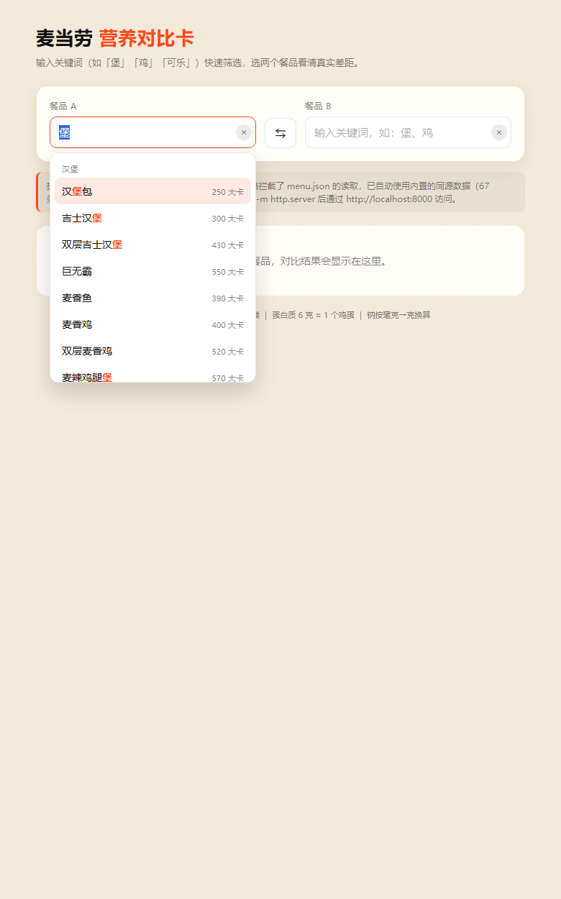
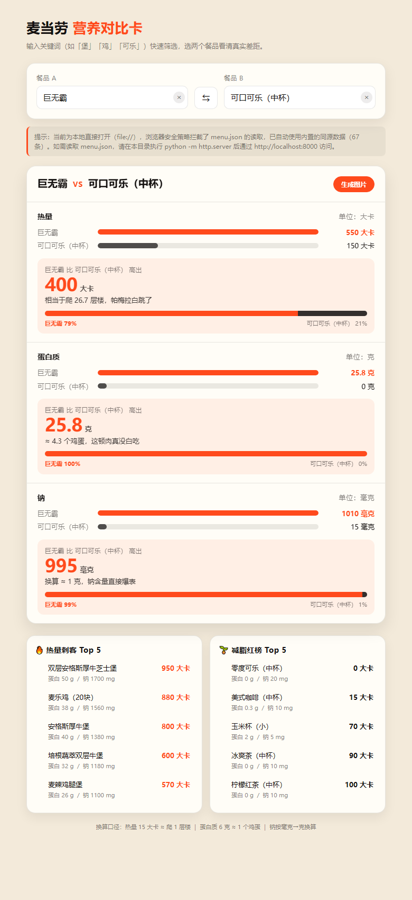
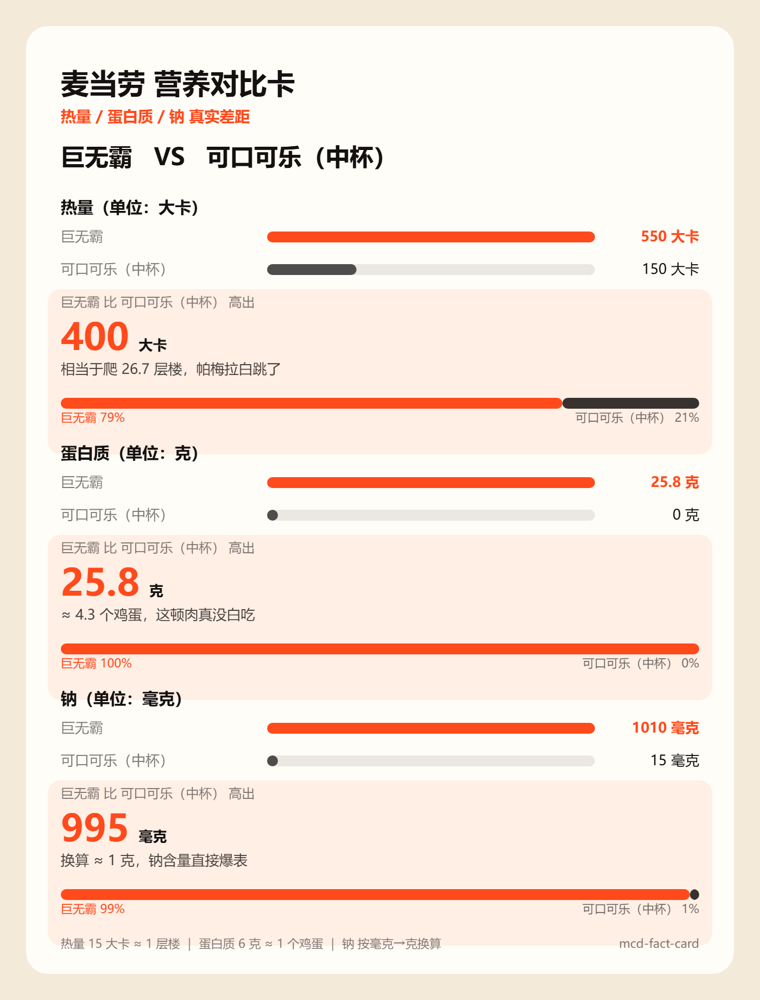
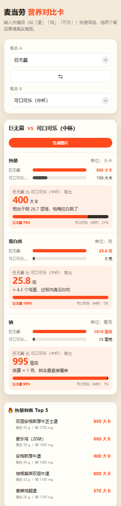

# 麦当劳营养对比卡（mcd-fact-card）

双标签页工具：**🍔 营养对比**（两个餐品看清热量/蛋白/钠的真实差距）+ **⏱️ 资产体检**（券/积分按过期倒计时排序、一键生成体检报告）。零依赖、断网可跑。

## 项目简介

- **定位**：把"这个比那个高多少"这种模糊感觉，换算成可感知的日常单位。
- **形态**：单文件前端（`index.html` 内联 CSS/JS）+ 一份样例数据（`menu.json`）。
- **依赖**：**零**。不使用 Vue / React / jQuery，不引外部字体、图标库、CDN、统计脚本。
- **网络**：断网可跑。所有资源均在本地，无任何外部请求。
- **数据**：内置 67 条麦当劳餐品营养估值（汉堡 / 小食 / 饮料 / 甜品 / 早餐），供演示与自测；真实数据源可平滑替换（见 `MCP_INTEGRATION.md`）。

### 效果一览

**关键词搜索**（输入「堡」实时过滤，按分类分组，命中字符朱橙高亮）：



**对比卡片**（巨无霸 vs 可口可乐·中杯，`file://` 双击场景实拍）：



**Canvas 导出的分享图**（点击「生成图片」实际下载的 PNG，非 mock）：



**手机 375px**（选择器/卡片/榜单自动单列堆叠，无横向溢出）：



> 纯文本版见下方 [预览](#预览) 章节。

### 换算口径

| 指标 | 原始单位 | 换算 | 人话 |
|---|---|---|---|
| 热量 | 大卡 (kcal) | 差值 ÷ 15 | 相当于爬多少**层楼** |
| 蛋白质 | 克 (g) | 差值 ÷ 6 | 相当于多少个**鸡蛋** |
| 钠 | 毫克 (mg) | 差值 ÷ 1000 | 相当于多少**克** |

### 视觉规范

| 角色 | 色值 |
|---|---|
| 纸色（背景） | `#F3EADA` |
| 墨色（文字） | `#141110` |
| 朱橙（强调） | `#FF4A1C` |

## 目录结构

```
mcd-fact-card/
├── index.html                 # 单文件应用（双 Tab：营养对比 + 资产体检，含全部兜底数据）
├── menu.json                  # 67 条餐品数据（唯一数据源脚本 _gen_data.py 生成）
├── assets.json                # 8 条模拟资产数据（券/积分/次数，含过期时间戳）
├── _gen_data.py               # 数据生成脚本：同时产出 menu.json / assets.json 与内嵌兜底数据
├── README.md                  # 本文件
├── SKILL.md                   # 能力说明书（标准格式）
├── MCP_INTEGRATION.md         # 未来接入 list-nutrition-foods 的计划
├── CONTEST_DECLARATION.md     # 参赛声明（空壳模板，待填写）
├── mcp-config.example.json    # MCP 配置示例（仅含 {{TOKEN}} 占位符）
├── S1验证报告.md              # 验收报告
├── workbuddy.md               # WorkBuddy 开发过程记录
└── docs/                      # 预览截图
    ├── screenshot-search.png
    └── screenshot-compare.png
```

## 预览

以下为 **`巨无霸` vs `可口可乐（中杯）`** 的真实运行效果（数值取自实机运行结果，非示意），
并附**搜索过滤**的展开示意（数据 67 条）：

```
+--------------------------------------------------------------------------+
| 麦当劳 营养对比卡                                                        |
| 输入关键词（如「堡」「鸡」「可乐」）快速筛选，选两个                     |
| 餐品看清热量、蛋白质与钠的真实差距。                                     |
|--------------------------------------------------------------------------|
| 餐品 A                              餐品 B                               |
|  +--------------------------+   <->   +--------------------------+       |
|  | 巨无霸              x    |   <->   |输入关键词，如：堡    x   |       |
|  +--------------------------+   <->   +--------------------------+       |
|--------------------------------------------------------------------------|
| [ 搜索过滤示意 ]  餐品 A 输入「堡」→                                     |
|   +----------------------------+                                         |
|   | 汉堡                        |   <- 分类分组                          |
|   | 汉[堡]包            250 大卡 |   <- 命中字符高亮                     |
|   | 吉士汉[堡]          300 大卡 |                                       |
|   | 巨无霸              550 大卡 |                                       |
|   | 麦辣鸡腿[堡]        570 大卡 |                                       |
|   | ...  共 14 条                |                                       |
|   +----------------------------+                                         |
|--------------------------------------------------------------------------|
| [ 对比卡片 ]   巨无霸   VS   可口可乐（中杯）                            |
|--------------------------------------------------------------------------|
| 热量   (单位: 大卡)                                                      |
|   巨无霸            ##############################  550 大卡             |
|   可口可乐（中杯）  ########                        150 大卡             |
|   >> 巨无霸 比 可口可乐（中杯） 高出 400 大卡    ≈ 26.7 层楼             |
|--------------------------------------------------------------------------|
| 蛋白质   (单位: 克)                                                      |
|   巨无霸            ##############################  25.8 克              |
|   可口可乐（中杯）  #                               0 克                 |
|   >> 巨无霸 比 可口可乐（中杯） 高出 25.8 克    ≈ 4.3 个鸡蛋             |
|--------------------------------------------------------------------------|
| 钠   (单位: 毫克)                                                        |
|   巨无霸            ##############################  1010 毫克            |
|   可口可乐（中杯）  #                               15 毫克              |
|   >> 巨无霸 比 可口可乐（中杯） 高出 995 毫克    ≈ 1 克                  |
|--------------------------------------------------------------------------|
| 换算口径: 热量 15 大卡 ≈ 1 层楼 | 蛋白质 6 克 ≈ 1 个鸡蛋 | 钠 mg → 克    |
+--------------------------------------------------------------------------+
```

**空态行为**（以下三种情况对比卡片都不会渲染）：

```
+--------------------------------------------------------------------------+
|  +--------------------------+    |    +--------------------------+       |
|  | 巨无霸                 v | <->|    | 巨无霸                 v |       |
|  +--------------------------+    |    +--------------------------+       |
|--------------------------------------------------------------------------|
|                                                                          |
|        请选择两个不同的餐品，对比结果会显示在这里。                      |
|                                                                          |
+--------------------------------------------------------------------------+
```

触发条件：① 未选餐品 ② 只选了一个 ③ 两边选了同款。

> 纯文本预览（无二进制依赖，终端/GitHub 均可直读）。
> 页面顶部「效果一览」为实拍截图，两者内容一致，可按阅读环境任选。
> 截图文件：`docs/screenshot-empty.png`、`docs/screenshot-compare.png`。

## 运行说明

### 方式一：双击打开（推荐，零门槛）

直接双击 `index.html`，用任意现代浏览器（Edge / Chrome / Firefox）打开即可。

> **已知行为说明**：以 `file://` 方式打开时，浏览器安全策略（CORS）会拦截页面对 `menu.json` 的读取。
> 本工具已内置**三级降级**：`fetch → XMLHttpRequest → 内置同源兜底数据`。
> 因此双击打开**依然能正常出卡片**，页面顶部会显示一条提示说明当前使用的是内置数据。
> `menu.json` 与内置数据完全一致，展示效果无差别。

### 方式二：本地服务器（可读取 menu.json）

在本目录下执行：

```bash
python -m http.server 8000
```

然后浏览器访问 <http://localhost:8000>。此时页面会直接读取 `menu.json`，顶部提示条不再出现。
修改 `menu.json` 后刷新页面即可看到变化 —— 这是验证数据源生效的推荐方式。

### 交互规则

- 两个**搜索输入框**（原生 `<datalist>`）分别选餐品 A / B：输入关键词（如「堡」「鸡」「可乐」）
  实时过滤，候选项附带「分类 · 热量」说明。
- **输入值合法性校验**：datalist 只是建议，手输不存在的名称会被判定为未选 —— 输入框里的名字
  永远对应真实的对比数据，不会出现"名字是 A、数据是 B"的错位。
- **未选**、**只选一个**、**两边选同款** 时，不显示对比卡片（显示空态提示）。
- 选中两个不同餐品后实时渲染卡片；输入框右侧 `×` 清除选择；中间 `⇄` 交换 A / B。

### 榜单与分享

- 页面底部「**🔥 热量刺客 Top 5**」（卡路里最高）与「**🌱 减脂红榜 Top 5**」（卡路里最低）
  直接读取数据按卡路里排序，每条附蛋白质与钠。
- 对比卡片右上角「**生成图片**」按钮：用原生 `<canvas>` 手绘当前对比卡并导出 PNG 下载
  （2 倍分辨率保证清晰度；**未使用 html2canvas 等任何外部库**；未绘制外部图片，
  画布不会被污染，`file://` 双击场景同样可用）。导出图与页面共用同一套换算/文案函数，不会各说各话。

### 资产体检（⏱️ Tab）

页面顶部两个 Tab 切换「🍔 营养对比」与「⏱️ 资产体检」。

- **数据**：`assets.json`（模拟的麦当劳用户资产：满减券 / 兑换券 / 抽奖次数 / 会员积分等），
  字段：名称、面值、单位、数量、单份估值（元）、过期时间戳。
- **排序**：未过期（剩余时间升序，最紧急在前）→ 已过期 → 未知时间。
- **高亮**：剩余 <24 小时的条目朱橙高亮并打「即将过期」标签；已过期置灰。
- **总览**：顶部两个大数字块 —— 当前总资产估值、24 小时内即将流失（金额 + 条数）。
- **生成体检报告**：原生 `<canvas>` 手绘报告卡（总估值 / 流失预警 / 全量清单）导出 PNG，
  与营养对比共用同一套绘制基建，**未引入任何外部库**。
- **异常处理**：时间戳解析失败（如空值、非法字符串）一律显示「未知时间」，绝不白屏。
- **兜底**：`assets.json` 读取失败时使用内嵌同源数据（与 menu.json 同一套三级降级）。
  过期时间戳以**数据生成时刻**为基准的相对偏移；重跑 `_gen_data.py` 即可刷新为当前时间。

### 视觉与响应式

- **字体层级**：差值采用「特大数字（34px/800）+ 小单位（13px）」的对比排版，一眼看到量级。
- **对比条**：每项差值下方有 A/B 占比切分的圆角对比条（A 朱橙、B 墨黑），附百分比图例。
- **情绪化文案**：换算按差值分档——热量差 ≥300 大卡触发「相当于爬 xx 层楼，帕梅拉白跳了」，
  钠差 ≥800mg 触发「钠含量直接爆表」；页面与导出图共用 `emotionText()`，口径唯一。
- **微交互**：卡片与指标块淡入动效（`fadeUp` / `pop`）、差值数字弹入、按钮 hover 上浮加深阴影、
  榜单行 hover 轻移。
- **响应式**：375px 下选择器与榜单单列堆叠、大数字自动缩至 27px、分享按钮全宽；
  已实测 `scrollWidth == clientWidth`（无横向溢出）。

## 数据格式

`menu.json` 字段约定：

```json
{
  "id": "big-mac",          // 唯一标识，稳定不变
  "name": "巨无霸",          // 展示名
  "category": "burger",     // 分类：burger / side / drink / dessert / breakfast
  "calories": 550,          // 热量，大卡
  "protein": 25.8,          // 蛋白质，克
  "sodium": 1010            // 钠，毫克（展示时换算为克）
}
```

> 修改数据请编辑 `_gen_data.py` 后运行它重新生成 —— 它同时产出 `menu.json` 与
> `index.html` 内嵌兜底数据，保证两者**绝对一致**（手动分别改两处必然漂移）。

替换数据时保持字段名与单位一致，页面无需改动。

## 已知限制

- 营养数据为**公开营养信息的近似估值**，非官方实时数据，不构成膳食建议。
- 差值换算（15 大卡/层楼、6g/鸡蛋）为便于感知的近似口径，非精确生理换算。
- 当前为纯前端静态页，不具备持久化与分享能力。

## 开发避坑（实测抓到的两个真问题）

这两个都不是"写代码时想到"的，而是**真机跑出来才暴露**的。

### 坑一：双击打开时读不到 `menu.json`（`file://` 跨域拦截）

- **现象**：以 `file://` 方式打开页面时，`menu.json` 读不到，下拉框为空。
- **根因**：Chromium（Chrome / Edge）的安全策略把每个本地文件视为独立来源（opaque origin），
  `fetch()` 与 `XMLHttpRequest` 读取本地 json 一律被 CORS 拦截。**这不是代码 bug，是浏览器设计如此**——
  但如果不处理，用户双击就是白屏，"双击可用"这条验收直接失效。
- **方案：三级降级**

  ```
  fetch('menu.json')  →  XMLHttpRequest  →  内置同源兜底数据
  ```

  前两级用于正常/宽松环境；都失败时回退到与 `menu.json` 完全一致的**内置数据**，
  页面照常出卡片，同时在顶部显示提示条说明当前状态并给出 `python -m http.server` 方案。
- **验证**：必须测两个分支，只测一个等于没测。
  1. 普通 `file://`（不加任何 flag）→ 提示条出现，卡片正常渲染 —— 证明双击场景可用；
  2. 加 `--allow-file-access-from-files`，并临时把 `menu.json` 改成 `巨无霸[MARK]` / 777 大卡
     → 页面输出 `777` 与 `[MARK]` 标记，换算 627÷15=41.8 层楼 —— **证明 `menu.json` 是真数据源，兜底只是安全网**。

### 坑二：差值文案语义反向（BUG-1，严重级）

- **现象**：选「薯条（大份）」vs「麦乐鸡（10块）」时，页面输出：

  ```
  麦乐鸡（10块） 比 薯条（大份） 低 14 克（≈ 2.3 个鸡蛋）
  ```

  但麦乐鸡蛋白质 19g、薯条 5g —— 麦乐明明**更高**，文案却说"低"，语义完全反了。

- **根因**：差值分支里**同时翻转了主语和动词**。当 A < B 时，代码把主语换成 B、动词换成"低"，
  于是得到"B 比 A 低 X"——而正确的表达是"B 比 A **高** X"（主语换了，动词就不该再翻）。

  ```js
  // 错误写法
  var lead = diff > 0 ? (a.name + " 比 " + b.name) : (b.name + " 比 " + a.name);
  var sign = diff > 0 ? "高出" : "低";        // ← 主语和动词一起翻，读起来就反了

  // 正确写法
  var higher = diff > 0 ? a : b;
  var lower  = diff > 0 ? b : a;
  // 主语固定为数值更高的一方，动词固定"高出"
  ```

- **为什么一开始没发现**：首轮测试数据用的是「巨无霸 vs 可口可乐」，巨无霸在三项上**全面碾压**，
  只走了 `diff > 0` 这一个分支，反向分支一次都没被执行 —— 缺陷被数据"掩盖"了。
  直到换成「薯条 vs 麦乐鸡」（互有胜负）才暴露。
- **修复**：主语固定为数值更高一方，动词固定"高出"。
- **教训（已固化进 `SKILL.md`）**：**对比类逻辑必须测双向数据**。
  只拿"A 全面碾压 B"的数据自测，等于只测了一半的代码路径。

### 顺带处理的两个小问题

- **钠的换算精度**：`Math.round(0.995 * 100) / 100` 在 JS 里等于 `1`（0.995×100 恰为 99.5），
  所以 995 毫克显示"≈ 1 克"——这是正确的四舍五入，不是 bug，但为统一口径改为显式保留 2 位小数。
- **差值为 0 的文案**：原逻辑会拼出"持平，差值 0 大卡"这种不通顺的句子，改为独立的"两者持平"分支。

## 路线图

- 接入 `list-nutrition-foods` MCP 数据源，替换静态 `menu.json`（计划见 `MCP_INTEGRATION.md`）。

## 许可

示例数据仅用于演示。麦当劳及餐品名称为各自权利人所有。
